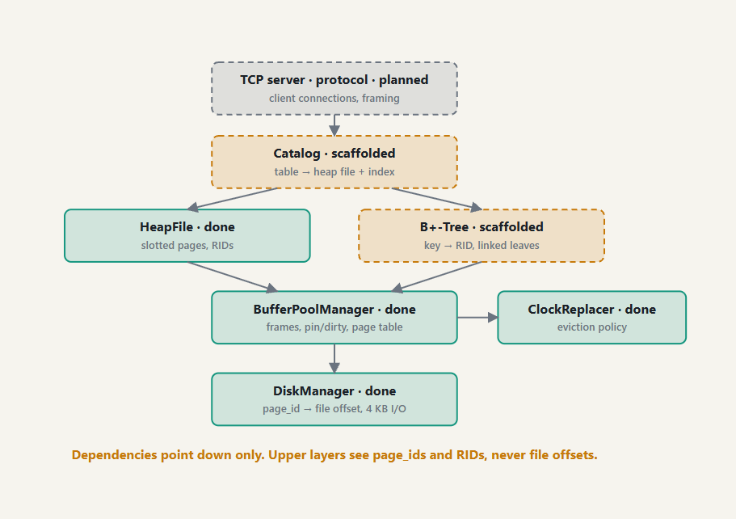
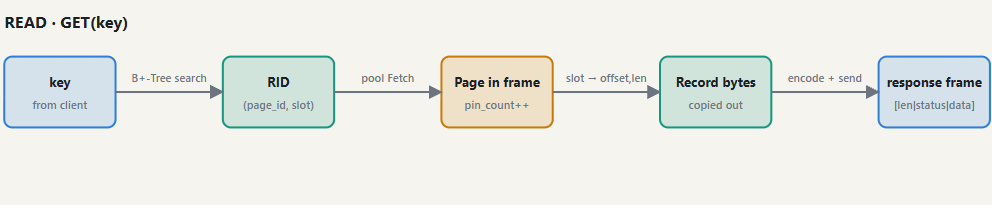
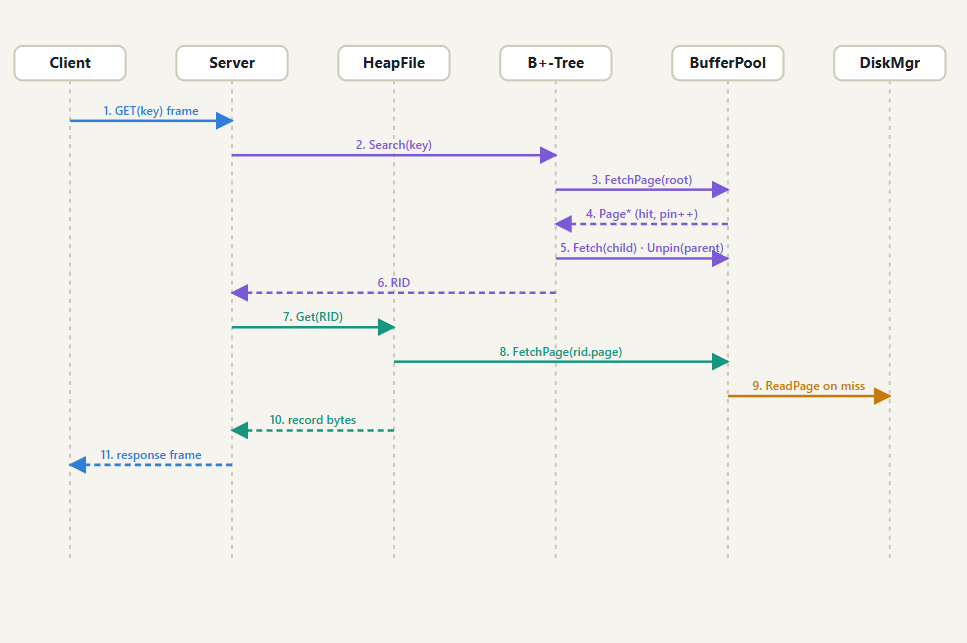
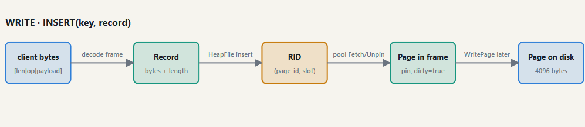
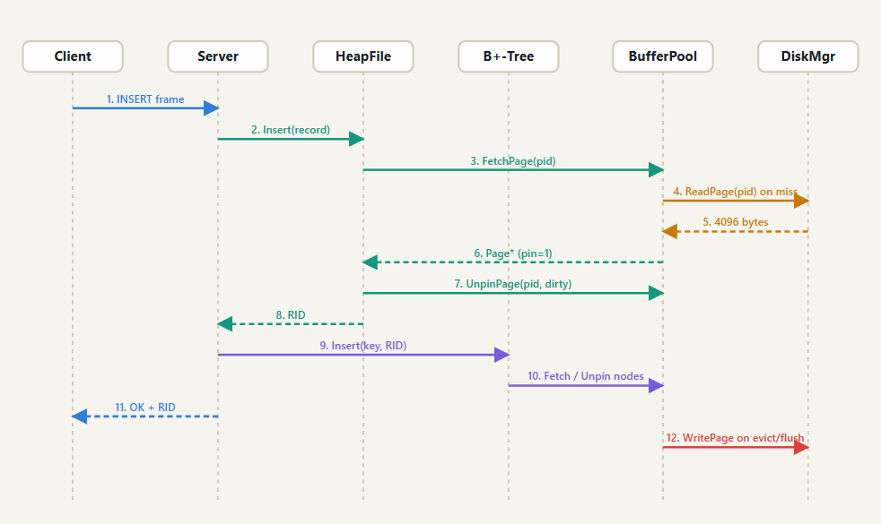

# mydb

A relational database engine built from scratch in C++ — page-based storage, buffer pool, B+ tree indexing, SQL parsing.


## storage 


## Get(search) Record Flow in Storage Component



## Insert Record Flow in Storage Component




**Status:** storage layer in progress, currently debugging a runtime error.

## Done
- `Page`, `DiskManager`, `ClockReplacer`, `BufferPoolManager`
- `HeapFile` — insert / get / update / delete / iterate
-  `BPlusTree` - indexing for faster search


## Not started
- Row/schema serialization, SQL parser, planner, executor, TCP server, WAL, transactions, locking

## Build

```bash
mkdir build && cd build
cmake ..
make
```

`main.cpp` is currently empty — this builds the storage layer only, no runnable entry point yet.

## Design

See [`ARCHITECTURE.md`](ARCHITECTURE.md) for the full layered design and build-order plan.
